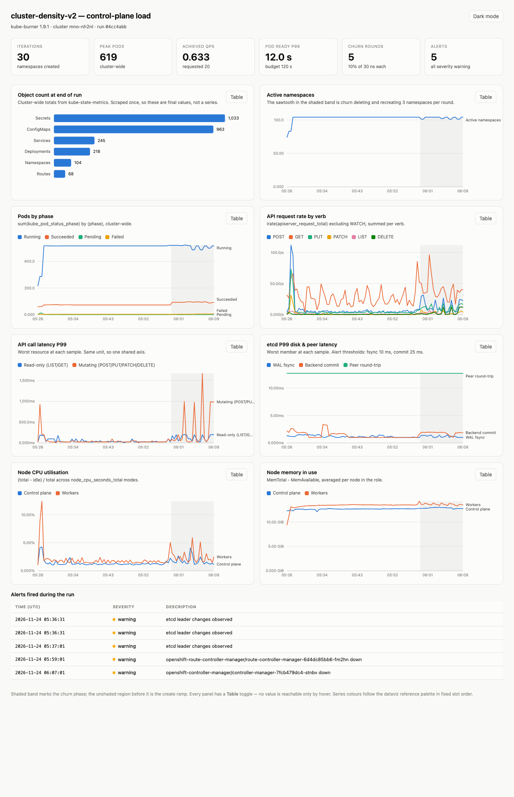
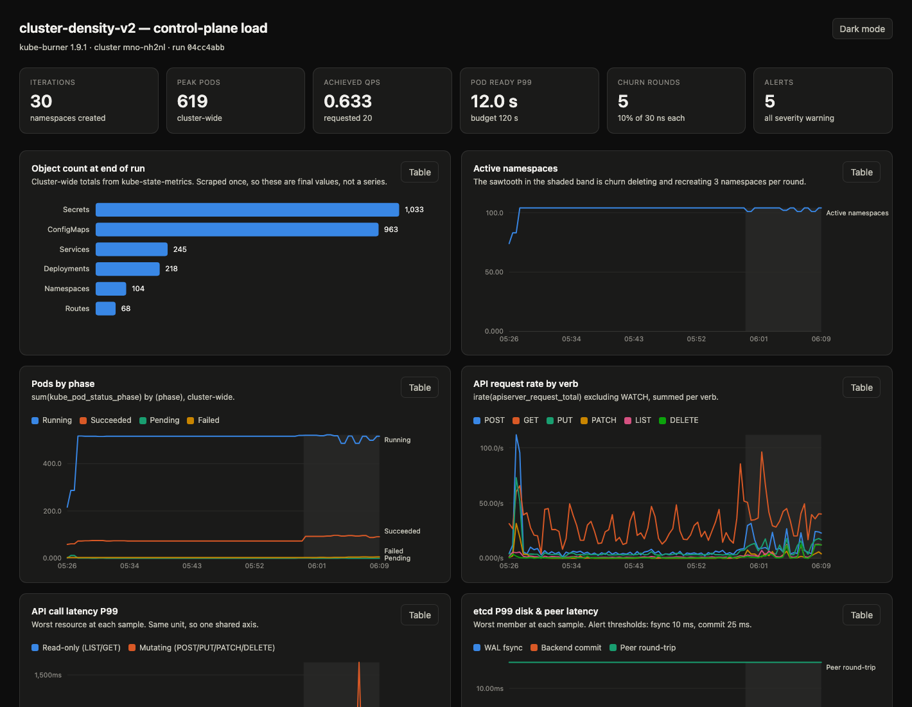

# kube-burner-dashboard

Turn a `kube-burner` **locally-indexed** metrics directory into a single
self-contained HTML dashboard — no OpenSearch, no Grafana, no server, no
network.

`kube-burner` can ship its metrics to OpenSearch, but on a disconnected or
throwaway cluster you usually just want to *look at the run*. With
`--local-indexing` it writes ~140 JSON files to disk instead. This project
renders those into one `.html` file you can open, archive, or email.



<details>
<summary>Dark mode</summary>


</details>

---

## Requirements

Python **3.8+**. Standard library only — no `pip install`, no virtualenv.

## Quick start

### 1. Produce the metrics

This is the step people miss: **`--local-indexing` is off by default**, and
without it (or `--es-server`) kube-burner writes no metrics directory at all.

```bash
kube-burner-ocp cluster-density-v2 --iterations=30 --local-indexing
```

That leaves a `collected-metrics-<uuid>/` directory beside the run.

### 2. Build the dashboard

```bash
python3 build_dashboard.py collected-metrics-<uuid>/ -o dashboard.html
open dashboard.html        # or xdg-open / just double-click it
```

### 3. Or get a terminal report

```bash
python3 process_metrics.py collected-metrics-<uuid>/
```

```
======================================================================
RUN SUMMARY  (jobSummary.json)
======================================================================
  uuid          04cc4abb-72f6-4149-97c6-4c259f50ea16
  passed        True
  elapsed       2632s
  iterations    30  qps=20 burst=20 gc=False
  achievedQps   0.633
  churn         600s @10% every 60s mode=namespaces
...
  -- etcd --
  max-cpu-etcd                                   0.441 cores
  max-99thEtcdDiskWalFsync                           1.53 ms
  max-99thEtcdDiskBackendCommit                      3.39 ms
```

---

## `build_dashboard.py`

```
build_dashboard.py <collected-metrics-dir> [-o OUT] [--title T] [--points N]
```

| Flag | Default | Meaning |
|---|---|---|
| `-o, --out` | `dashboard.html` | output file |
| `--title` | `kube-burner run` | heading shown at the top |
| `--points` | `280` | per-series downsample cap |

### Panels

Panels are skipped automatically when their source metrics are absent, so
this works across metrics profiles.

| Panel | Source | Notes |
|---|---|---|
| Object count at end of run | `secretCount`, `configmapCount`, `serviceCount`, `deploymentCount`, `namespaceCount`, `routeCount` | bars — these are scraped once |
| Active namespaces | `namespaceCount` | churn shows as a sawtooth |
| Pods by phase | `podStatusCount` | |
| API request rate by verb | `APIRequestRate` | top 6 verbs |
| API call latency P99 | `readOnlyAPICallsLatency`, `mutatingAPICallsLatency` | worst resource per sample |
| etcd P99 disk & peer latency | `99thEtcd*DurationSeconds`, `99thEtcdRoundTripTimeSeconds` | worst member per sample |
| Node CPU utilisation | `nodeCPU-Masters`, `nodeCPU-AggregatedWorkers` | `(total − idle) / total` |
| Node memory in use | `nodeMemoryUtilization-*` | `MemTotal − MemAvailable` |
| Alerts table | `alert.json` | |

The **churn window** (from `jobSummary.json`) is shaded on every time chart,
so the create ramp and the churn phase are visually separable.

## `process_metrics.py`

```
process_metrics.py <dir>                  # headline report
process_metrics.py <dir> --all-scalars    # every scalar metric
process_metrics.py <dir> --show NAME      # dump one series
process_metrics.py <dir> --csv out/       # every series -> CSV for pandas/Excel
```

---

## Understanding the data format

Every file in `collected-metrics-<uuid>/` is a **flat JSON array of
documents** — exactly what kube-burner would have POSTed to OpenSearch. Four
shapes:

| Shape | Looks like | Example |
|---|---|---|
| scalar | 1 doc, no `.labels` | `max-cpu-etcd.json` |
| timeseries | N docs, each with `.labels` | `podStatusCount.json` |
| measurement | per-pod / per-quantile rows | `podLatencyQuantilesMeasurement-<job>.json` |
| meta | run metadata | `jobSummary.json`, `alert.json` |

Each document carries `.uuid`, `.metricName`, `.jobName`, `.metadata`, and —
most usefully — **`.query`**, the PromQL that produced it:

```json
{"timestamp":"2026-11-24T06:09:53.674Z","value":0.4407,
 "query":"max(max_over_time(topk(3, sum(irate(container_cpu_usage_seconds_total{namespace=\"openshift-etcd\"}[2m])) by (pod))[2631s:]))",
 "metricName":"max-cpu-etcd","jobName":"cluster-density-v2"}
```

### Three traps worth knowing

These each cost a debugging round when this tool was written.

**1. Some "metrics" are a single sample, not a series.** `secretCount`,
`configmapCount`, `serviceCount`, `deploymentCount` and `routeCount` are
instant `count(...)` queries scraped once (`n=1`). Plotting them as lines
draws *nothing* — a one-point SVG path is a bare `moveto`. That's why this
tool renders them as bars.

**2. Don't infer units from the metric name — read `.query`.**
`max-99thEtcdCompaction` uses `..._milliseconds_sum`, so its value is
*already* milliseconds; its sibling `max-99thEtcdDefrag` uses
`_seconds_sum` and does need scaling. Likewise
`max-memory-cluster-usage-ratio` is a **ratio**, not bytes, despite "memory"
in the name.

**3. The scalars are pre-aggregated over the whole run.** Note the `[2631s:]`
baked into the query above — that's the full run duration. These values
cannot be re-sliced to a sub-window. If you need window-scoped numbers
(e.g. churn phase only), query Prometheus/Thanos directly using the
timestamps in `jobSummary.json`.

---

## Design & accessibility

- **Self-contained.** Data is inlined and charts are drawn as SVG by vanilla
  JS. No CDN, no fonts, no build step, no telemetry. Works offline and from
  `file://`.
- **Colour.** Six categorical hues assigned in fixed slot order, never
  cycled. Light and dark are separately-chosen steps, not an automatic flip.
- **Validated, not eyeballed.** `tools/validate_palette.py` checks the
  lightness band, chroma floor, colour-vision-deficiency separation
  (Machado–Oliveira–Fernandes 2009, severity 1.0), the normal-vision floor,
  and WCAG contrast. Current palette: adjacent CVD ΔE **9.1** light / **8.4**
  dark, normal-vision ΔE **19.6** / **19.3** — passes in both modes.
  ```bash
  python3 tools/validate_palette.py "#2a78d6,#eb6834,#1baf7a,#eda100,#e87ba4,#008300" --mode light
  ```
- **Never colour-alone.** Every panel has a legend, ≤4-series panels are
  direct-labelled (with collision avoidance), and **every panel has a Table
  toggle** — no value is reachable only by hovering.
- **No dual axes.** Series sharing a panel always share a unit.

### Re-theming

Swap the `--s1`…`--s6` custom properties in the `<style>` block of the `HTML`
template in `build_dashboard.py` (both the light block and the two dark
blocks), then re-run the validator against your surfaces before shipping.

---

## Limitations

- Built against the OpenShift metrics profile (`metrics-aggregated.yml`) from
  `kube-burner-ocp`. Vanilla `kube-burner` profiles expose different metric
  names; unknown panels are skipped rather than erroring.
- Time series are downsampled by bucket mean (max for latency). Raise
  `--points` for more fidelity, or use `process_metrics.py --csv` for the
  full-resolution data.
- Single-run only. There's no A/B comparison between two UUIDs.

## Contributing

Issues and PRs welcome — particularly extra panels and support for non-OCP
metrics profiles.

## License

MIT — see [LICENSE](LICENSE). (You may prefer Apache-2.0 to match
[kube-burner](https://github.com/kube-burner/kube-burner) itself; swap the
file if so.)

Not affiliated with the kube-burner project.
